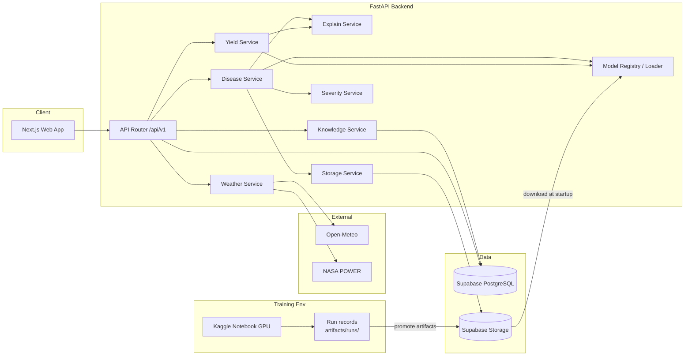
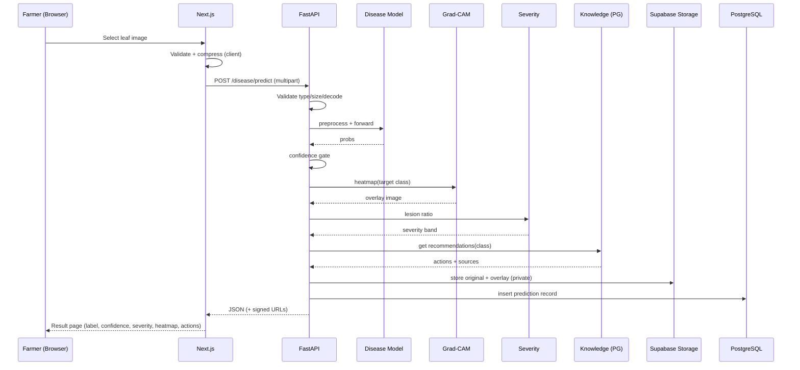
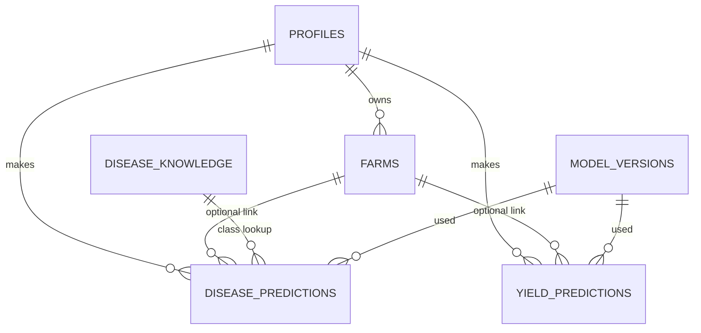

# ARCH — System Architecture

| Field | Value |
|---|---|
| Document | Architecture Specification |
| Version | 1.0 (Draft) |
| Date | 24 Oct 2026 |
| Related | `PRD.md`, `SRS.md`, `DEV_PLAN.md` |

---

## 1. Architectural Overview

AgriSense AI is a **three-tier web application with an embedded ML-serving layer**, supported by an **offline ML training/experimentation environment**.

```
                       ┌──────────────────────────────────────────────┐
                       │                OFFLINE (Training)            │
                       │  Kaggle Notebook GPU ──► ml/ code ──► run records │
                       │        │                              │      │
                       │   PlantVillage / Yield datasets       ▼      │
                       │                           Model artifacts    │
                       └──────────────────────────────┬───────────────┘
                                                      │ promote
                                                      ▼
┌──────────┐  HTTPS   ┌────────────────┐  REST/JSON  ┌────────────────────────────────┐
│  Farmer  │────────► │ Next.js (Vercel)│───────────►│ FastAPI backend (Docker)        │
│ (browser)│◄──────── │ React/TS/Tailwind│◄───────────│  ├─ Disease service (PyTorch)   │
└──────────┘          │ Recharts        │            │  ├─ Yield service (sklearn/XGB/ │
                      └───────┬────────┘            │  │   LSTM)                      │
                              │ (optional auth)      │  ├─ Explainability (Grad-CAM,   │
                              ▼                      │  │   SHAP)                      │
                      ┌────────────────┐            │  ├─ Knowledge service           │
                      │ Supabase Auth  │            │  ├─ Weather service ──► Open-   │
                      └────────────────┘            │  │   Meteo / NASA POWER         │
                                                    │  └─ Storage service ──► Storage  │
                                                    └───────┬─────────────┬───────────┘
                                                            ▼             ▼
                                                  Supabase PostgreSQL  Supabase Storage
                                                  (metadata, history,   (leaf images,
                                                   knowledge base)       Grad-CAM, models)
```

### 1.1 Architectural Principles
1. **Separation of concerns** — training (offline, Kaggle) is separate from serving (online, CPU).
2. **Explainability is part of the response contract**, not an afterthought.
3. **Knowledge ≠ model** — treatment advice comes from a curated DB, never from the classifier.
4. **Model-agnostic serving** — models are loaded through a registry interface, so ResNet/EfficientNet/ViT or RF/XGBoost/LSTM can be swapped without API changes.
5. **Reproducibility** — every served model maps to a run record, git commit, config, and data version.
6. **Graceful degradation** — fallbacks for weather providers, low-confidence predictions, and cold starts.
7. **Portability** — Docker for backend; no vendor-specific logic outside thin adapters (storage, DB).

---

## 2. Technology Stack (Final)

| Layer | Technology | Purpose / Notes |
|---|---|---|
| Programming | **Python**, **TypeScript** | Python: ML + backend. TypeScript: frontend. |
| Disease AI | **PyTorch, Torchvision, timm**; CNNs, **ResNet / EfficientNet**, **Vision Transformer** | Baseline CNN vs. pretrained CNNs vs. ViT; fine-tuning + augmentation |
| Yield ML | **Pandas, NumPy, Scikit-learn, XGBoost**, **LSTM / Transformer** (PyTorch) | LR, RF, XGBoost baselines; LSTM/Transformer if time-series data allows |
| Explainability | **Grad-CAM**, **SHAP** | Image-region attribution; tabular feature attribution |
| Backend | **FastAPI**, REST APIs | Async API, Pydantic validation, OpenAPI docs |
| Frontend | **Next.js, React, TypeScript, Tailwind CSS, Recharts** | App Router, responsive UI, charts |
| Data / Weather | **Open-Meteo, NASA POWER**, public agricultural datasets | Weather retrieval + training data |
| Database | **Supabase PostgreSQL** | Metadata, history, knowledge base |
| Storage | **Supabase Storage** (S3-compatible object storage) | Leaf uploads, heatmaps, model artifacts |
| AI Training | **Kaggle Notebooks** (GPU) | Training & experimentation |
| MLOps | **Git, GitHub, JSON run records** | Tracking, provenance, versioning, CI |
| Deployment | **Docker; Vercel; Render / Hugging Face / Cloud** | Frontend on Vercel; backend container on Render/HF/Cloud |

### 2.1 Supporting libraries (recommended, not in the PDF)
| Concern | Library | Reason |
|---|---|---|
| Grad-CAM implementation | `pytorch-grad-cam` | Mature, supports CNN + ViT reshape transforms |
| Image processing | `Pillow`, `OpenCV (headless)`, `albumentations` | Preprocessing, augmentation, lesion segmentation |
| Validation/config | `pydantic`, `pydantic-settings`, `PyYAML` | Typed config and schemas |
| DB access | `SQLAlchemy 2.x`, `asyncpg` / `psycopg`, `Alembic` | ORM + migrations (or Supabase client) |
| Object storage | Supabase REST API (`httpx`); `boto3` on the S3-compatible endpoint | Backend uses the REST API; training uploads via S3 |
| HTTP | `httpx` | Async calls to weather APIs |
| Caching | in-process TTL cache (`cachetools`); optional Redis later | Weather + knowledge cache |
| Inference optimization | `onnxruntime` (optional) | Smaller/faster CPU serving |
| Run tracking | `ml/src/common/tracking.py` (standard library only) | JSON run record + append-only index; no server, no account (ADR-0012) |
| Testing | `pytest`, `pytest-asyncio`, `httpx`; frontend: `vitest`/`jest`, `playwright` | Unit/integration/e2e |
| Quality | `ruff`, `black`, `mypy`; `eslint`, `prettier` | Lint/format/type-check |
| Frontend data | `@tanstack/react-query`, `zod`, `react-hook-form` | Server state, validation, forms |
| Auth (optional) | `@supabase/supabase-js` | Login + session |

---

## 3. Logical Architecture

### 3.1 Component Diagram


### 3.2 Component Responsibilities
| Component | Responsibility |
|---|---|
| **Next.js app** | Pages, forms, image upload (client-side compression), result visualisation, charts, optional auth |
| **API Router** | Versioned REST endpoints, validation, error mapping, CORS, rate limiting |
| **Disease Service** | Preprocess image → run classifier → postprocess (softmax, top-k, thresholds) |
| **Severity Service** | Leaf/lesion segmentation → severity ratio → band |
| **Yield Service** | Feature assembly, scaling/encoding, model inference, risk calculation |
| **Explain Service** | Grad-CAM overlay generation; SHAP values and plain-language summaries |
| **Knowledge Service** | Fetch curated recommendations for a disease class |
| **Weather Service** | Provider abstraction (Open-Meteo, NASA POWER), retries, fallback, caching |
| **Storage Service** | Upload/download/presign objects in Supabase Storage (REST API), strip EXIF before upload |
| **Model Registry/Loader** | Resolve "production" model per pipeline, download artifacts, warm-load at startup, expose model metadata |
| **Persistence layer** | Save prediction records and metadata to PostgreSQL |

---

## 4. Repository & Folder Structure (Monorepo)

> Note: `yield` is a Python keyword, so the yield packages are named `crop_yield`.

```
agri-ai-platform/
├── README.md                      # Project intro, quickstart, links to docs
├── LICENSE
├── .gitignore
├── .env.example                   # All env vars (no secrets)
├── Makefile                       # make setup | dev | test | lint | docker-up
├── docker-compose.yml             # Local: backend (+ optional postgres, minio)
│
├── .github/
│   ├── workflows/
│   │   ├── ci-backend.yml         # ruff, mypy, pytest
│   │   ├── ci-frontend.yml        # eslint, tsc, vitest, build
│   │   ├── ci-ml.yml              # lint + small smoke tests on ml/src
│   │   └── deploy-backend.yml     # build & push Docker image / trigger Render
│   ├── PULL_REQUEST_TEMPLATE.md
│   └── ISSUE_TEMPLATE/
│
├── docs/
│   ├── PRD.md
│   ├── SRS.md
│   ├── ARCH.md
│   ├── DEV_PLAN.md
│   ├── adr/                       # Architecture Decision Records (0001-*.md)
│   ├── api/openapi.json           # Exported OpenAPI spec
│   ├── diagrams/                  # .mmd / .png diagrams
│   ├── model_cards/               # disease_model_card.md, yield_model_card.md
│   ├── reports/                   # experiment reports, final report, slides
│   └── knowledge_sources.md       # Provenance of KB content
│
├── frontend/                      # Next.js + React + TypeScript + Tailwind
│   ├── package.json
│   ├── next.config.ts
│   ├── tailwind.config.ts
│   ├── tsconfig.json
│   ├── .env.local.example
│   ├── public/
│   │   ├── sample-leaves/         # demo images
│   │   └── icons/
│   ├── src/
│   │   ├── app/                   # App Router
│   │   │   ├── layout.tsx
│   │   │   ├── page.tsx           # Landing / quick actions
│   │   │   ├── dashboard/page.tsx # Combined results dashboard
│   │   │   ├── disease/page.tsx   # Upload + results + Grad-CAM
│   │   │   ├── yield/page.tsx     # Form + results + SHAP
│   │   │   ├── history/page.tsx   # (stretch) saved predictions
│   │   │   ├── about/page.tsx     # Model cards, limitations
│   │   │   └── (auth)/login/page.tsx  # (stretch)
│   │   ├── components/
│   │   │   ├── ui/                # Button, Card, Badge, Skeleton, Alert...
│   │   │   ├── layout/            # Navbar, Footer, DisclaimerBanner
│   │   │   ├── disease/           # ImageUploader, GradCamViewer, SeverityBadge,
│   │   │   │                      #   ConfidenceBar, RecommendationList
│   │   │   ├── yield/             # YieldForm, WeatherPanel, RiskBadge, ShapChart
│   │   │   └── dashboard/         # HealthCard, YieldCard, TrendChart
│   │   ├── lib/
│   │   │   ├── api-client.ts      # Typed fetch wrapper for backend
│   │   │   ├── supabase.ts        # (stretch)
│   │   │   ├── image.ts           # client-side compression/validation
│   │   │   ├── validators.ts      # zod schemas
│   │   │   └── utils.ts
│   │   ├── hooks/                 # useDiseasePredict, useYieldPredict, useWeather
│   │   ├── types/                 # API response types (mirrors backend schemas)
│   │   └── styles/globals.css
│   └── tests/                     # unit (vitest) + e2e (playwright)
│
├── backend/                       # FastAPI service
│   ├── pyproject.toml             # or requirements.txt
│   ├── Dockerfile
│   ├── .dockerignore
│   ├── alembic.ini
│   ├── app/
│   │   ├── main.py                # App factory, lifespan (model warm-load), CORS
│   │   ├── core/
│   │   │   ├── config.py          # pydantic-settings (env)
│   │   │   ├── logging.py         # structured logging + request IDs
│   │   │   ├── errors.py          # custom exceptions + handlers
│   │   │   ├── security.py        # JWT verify (Supabase), rate limit helpers
│   │   │   └── constants.py
│   │   ├── api/
│   │   │   ├── deps.py            # DI: db session, services, current_user
│   │   │   └── v1/
│   │   │       ├── router.py
│   │   │       └── endpoints/
│   │   │           ├── health.py
│   │   │           ├── disease.py
│   │   │           ├── crop_yield.py
│   │   │           ├── weather.py
│   │   │           ├── knowledge.py
│   │   │           ├── history.py
│   │   │           └── models_info.py
│   │   ├── schemas/               # Pydantic request/response models
│   │   │   ├── disease.py  crop_yield.py  weather.py  knowledge.py  common.py
│   │   ├── services/
│   │   │   ├── disease_service.py
│   │   │   ├── severity_service.py
│   │   │   ├── yield_service.py
│   │   │   ├── explain_service.py
│   │   │   ├── knowledge_service.py
│   │   │   ├── weather_service.py
│   │   │   ├── storage_service.py
│   │   │   └── history_service.py
│   │   ├── ml/
│   │   │   ├── registry.py        # resolve/download/load production models
│   │   │   ├── preprocessing.py   # image transforms (must match training)
│   │   │   ├── gradcam.py         # Grad-CAM wrapper
│   │   │   ├── shap_explainer.py  # SHAP wrapper (Tree/Deep/Kernel)
│   │   │   ├── features.py        # yield feature builder (must match training)
│   │   │   ├── risk.py            # risk-level logic
│   │   │   └── labels.py          # class index ↔ name mapping
│   │   ├── db/
│   │   │   ├── session.py
│   │   │   ├── models.py          # SQLAlchemy models
│   │   │   └── migrations/        # Alembic versions
│   │   └── utils/                 # image utils, time utils
│   ├── tests/
│   │   ├── unit/
│   │   ├── integration/
│   │   └── fixtures/              # sample leaves, sample payloads
│   └── scripts/                   # seed_knowledge.py, warmup.py
│
├── ml/                            # Offline training & experimentation
│   ├── README.md
│   ├── requirements-kaggle.txt    # deps Kaggle does not ship (never torch)
│   ├── configs/
│   │   ├── disease/               # baseline_cnn.yaml, resnet50.yaml,
│   │   │                          #   efficientnet_b0.yaml, vit_b16.yaml
│   │   └── crop_yield/            # lr.yaml, rf.yaml, xgb.yaml, lstm.yaml, transformer.yaml
│   ├── data/                      # GIT-IGNORED (use scripts to fetch)
│   │   ├── raw/  interim/  processed/  external/
│   ├── notebooks/
│   │   ├── kaggle/
│   │   │   ├── 00_kaggle_setup.ipynb
│   │   │   ├── 01_plantvillage_eda.ipynb
│   │   │   ├── 02_disease_training.ipynb
│   │   │   ├── 03_yield_eda.ipynb
│   │   │   ├── 04_yield_training.ipynb
│   │   │   └── 05_explainability_analysis.ipynb
│   ├── src/
│   │   ├── common/                # seed.py, paths.py, tracking.py, metrics.py, io.py, logging.py
│   │   ├── disease/
│   │   │   ├── dataset.py  transforms.py  models.py  train.py
│   │   │   ├── evaluate.py  gradcam_eval.py  severity.py  export.py (TorchScript/ONNX)
│   │   ├── crop_yield/
│   │   │   ├── ingest.py  weather_pull.py  features.py  baselines.py
│   │   │   ├── xgb_model.py  sequence_models.py  train.py  evaluate.py
│   │   │   ├── shap_analysis.py  risk.py
│   │   └── knowledge/build_kb.py  # JSON → DB seed
│   ├── knowledge_base/
│   │   ├── disease_knowledge.json # curated, with source references
│   │   └── sources.md
│   ├── models/                    # GIT-IGNORED; local exports + registry.json pointer
│   ├── reports/figures/           # confusion matrices, SHAP plots, curves
│   └── tests/
│
├── infra/
│   ├── docker/                    # extra Dockerfiles (optional local object store, etc.)
│   ├── render.yaml                # Render blueprint (if used)
│   └── hf_space/                  # HF Spaces config (if used)
│
└── scripts/
    ├── bootstrap.sh               # create folders, venvs, install hooks
    ├── download_plantvillage.sh
    └── export_openapi.py
```

---

## 5. Data Architecture

### 5.1 Data Sources
| Domain | Source | Notes |
|---|---|---|
| Disease images | **PlantVillage** (primary); additional real-world/field images (evaluation + augmentation) | Document licence; keep a held-out field set |
| Weather (live + historical) | **Open-Meteo**, **NASA POWER** | Temperature, rainfall, humidity, solar radiation, wind, etc. |
| Yield history | Public agri datasets, Kaggle, government/open-data portals, FAOSTAT-style data | Selected by crop & geography |
| Soil | Public soil datasets/portals (e.g., global/regional soil grids) | pH, organic carbon, texture, N/P/K where available |

### 5.2 Data Layout in `ml/data/` (git-ignored; versioned by manifest)
```
raw/            # untouched downloads (plantvillage/, yield_csv/, weather/)
interim/        # cleaned/merged intermediate tables
processed/      # train/val/test splits, feature tables, tensors
external/       # field images, annotation files
manifests/      # data_manifest.json: source URL, date, checksum, split seed
```
Data versions are identified by `data_manifest.json` (checksum + split seed) and recorded in every run's `run.json`.

### 5.3 Split Strategy
| Pipeline | Strategy | Reason |
|---|---|---|
| Disease | Stratified 70/15/15 train/val/test; **group-aware** if duplicates/augmented variants exist (avoid leakage); separate **field-image** test set | Leakage in PlantVillage is a known risk |
| Yield (tabular) | **Time-based** or **leave-one-year/region-out** split | Avoids look-ahead leakage; mimics true forecasting |
| Yield (sequence) | Rolling-window / expanding-window validation | Respects temporal order |

---

## 6. ML Architecture

### 6.1 Disease Detection Pipeline
```
Image bytes
  └─► validate (type, size, decodable)
  └─► resize (e.g., 224×224; 256→center crop) → RGB → normalize (ImageNet mean/std)
  └─► Classifier (ResNet50 | EfficientNet-B0/B3 | ViT-B/16)  [timm / torchvision]
  └─► logits → softmax → top-k
  └─► confidence gate (e.g., max_prob < τ → "uncertain")
  ├─► Grad-CAM (target layer per architecture) → heatmap → overlay PNG
  └─► Severity Service (leaf mask + lesion mask → ratio → band)
  └─► Knowledge lookup (class → recommendations)
```

**Experiment matrix (all recorded as runs):**
| Exp ID | Model | Init | Aug | Notes |
|---|---|---|---|---|
| D-01 | Baseline small CNN | scratch | basic | reference floor |
| D-02 | ResNet-50 | ImageNet | basic | frozen head → full fine-tune |
| D-03 | EfficientNet-B0 | ImageNet | basic | compact candidate for free-tier serving |
| D-04 | ViT-B/16 (timm) | ImageNet | basic | transformer comparison |
| D-05 | Best of above | ImageNet | **strong** (random background, colour jitter, blur, cutout) | domain-gap mitigation |
| D-06 | Best of above | — | strong + label smoothing / mixup | calibration/robustness |
| D-07 | Evaluation on **field images** | — | — | measure generalization gap |

**Selection criteria:** macro-F1 (val) → field-set F1 → latency & memory on CPU → model size. A compact model that is ~1% worse but fits free-tier hosting is acceptable (document the trade-off in an ADR).

**Calibration:** temperature scaling on validation set so that confidence is meaningful; report ECE.

**Grad-CAM target layers:**
| Architecture | Target layer |
|---|---|
| ResNet-50 | `layer4[-1]` |
| EfficientNet | last conv block (`conv_head` / final `features` block) |
| ViT-B/16 | last transformer block `norm1` with `reshape_transform` (tokens → 14×14 grid) |

### 6.2 Severity Estimation
```
RGB image
 ├─► Leaf mask: HSV/Lab thresholding + morphology (or GrabCut / light U-Net)
 ├─► Lesion mask: pixels within leaf that deviate from healthy-green range
 ├─► ratio = lesion_px / leaf_px
 └─► band: <10% Low | 10–30% Moderate | >30% Severe  (configurable)
Cross-check: Grad-CAM active-area fraction (supporting signal only)
```
Output is presented as **"estimated severity"**; method validated on a small annotated subset; limitations documented.

### 6.3 Yield Prediction Pipeline
```
Request (crop, location, season, area, soil?, weather overrides?)
  └─► Weather Service → daily/weekly aggregates over growth window
  └─► Soil lookup/manual
  └─► Feature builder (same code path as training)
        - static: crop, region, soil props, area
        - weather aggregates: mean/min/max temp, total rain, rainy days, humidity, GDD, solar
        - lagged/historical: prior-year yield, 3/5-yr mean, trend
        - temporal sequence (for LSTM/Transformer): weekly weather series
  └─► Model (production version)
  └─► predicted yield (+ interval)
  └─► Risk engine
  └─► SHAP explanation + plain-language sentences
```

**Experiment matrix:**
| Exp ID | Model | Notes |
|---|---|---|
| Y-00 | Naïve baseline (historical mean / last year) | sanity floor |
| Y-01 | Linear Regression (+ Ridge/Lasso) | interpretable baseline |
| Y-02 | Random Forest | non-linear baseline |
| Y-03 | XGBoost (tuned: Optuna/random search) | expected strongest tabular |
| Y-04 | LSTM on weekly weather sequences + static features | only if temporal data is sufficient |
| Y-05 | Transformer encoder (time-series) | only if sufficient data; otherwise documented as "not supported by data" |
| Y-06 | Best model + quantile/conformal intervals | uncertainty |

**Metrics:** MAE, RMSE, R² (overall + per crop + per region + under *unusual* weather years).

**Risk Engine (default definition, tunable):**
```
ratio = predicted_yield / historical_baseline(crop, region)   # e.g., 5-yr mean
interval_width = (upper - lower) / predicted_yield

Low    : ratio ≥ 0.95
Medium : 0.80 ≤ ratio < 0.95   OR interval_width > threshold
High   : ratio < 0.80
```
The method is documented and backtested on historical years (does "High" really coincide with poor years?).

**SHAP strategy:**
| Model | Explainer |
|---|---|
| RF / XGBoost | `shap.TreeExplainer` (fast, exact) — **preferred production path** |
| Linear | `shap.LinearExplainer` |
| LSTM / Transformer | `GradientExplainer`/`DeepExplainer`, or fall back to surrogate-tree/`KernelExplainer` on aggregated features |

Output: top-N features with signed contribution + auto-generated plain-language sentence templates (e.g., "`rain_total_jul` was below the typical range → decreased yield by ~0.3 t/ha").

### 6.4 Model Registry & Serving
- **Training:** each run writes a JSON record (params, metrics, confusion matrix/plots, model artifact paths, label map, preprocessing config, data manifest, git SHA, environment) under `artifacts/runs/<run_id>/run.json` and appends a summary line to `artifacts/runs/index.jsonl` (ADR-0012).
- **Promotion:** the chosen run is exported (TorchScript/ONNX or `state_dict` + `timm` name; `joblib`/`xgboost` JSON for tabular) and uploaded to Supabase Storage under `models/{pipeline}/{version}/`, with a `model_card.json` that carries the originating `run_id`.
- **Pointer file:** `models/production.json` in Supabase Storage (or env var) specifies the active version per pipeline.
- **Serving:** at FastAPI startup (`lifespan`), the loader downloads (if not cached) and loads the production models; `/api/v1/models` exposes name, version, metrics, trained date.
- **Rollback:** change pointer to previous version and restart/redeploy.

```
ml/ (Kaggle) ──► run.json + artifacts ──► export ──► Supabase Storage: models/disease/v1.2.0/{model.onnx|pt, labels.json, config.json, card.json}
                                                    └► Supabase Storage: models/production.json  {"disease":"v1.2.0","yield":"v0.9.1"}
backend startup ──► read production.json ──► download ──► load into memory ──► ready
```

### 6.5 Experiment Tracking (run records, no server)
`ml/src/common/tracking.py` — standard library only, so it imports cleanly in CI and notebooks:

```
artifacts/runs/
├── index.jsonl                      # one summary object per run (append-only)
└── 20261024T101500Z-D-03-a1b2c3/
    ├── run.json                     # the full record
    └── <artifacts…>                 # checkpoints, plots, reports
```

| Item | Convention |
|---|---|
| Run id | `{UTC timestamp}-{name}-{short uuid}` |
| Run name | `{exp_id}-{model}-{short-desc}` e.g., `D-03-effnetb0-strongaug` |
| Params | architecture, lr, batch size, epochs, aug config, seed, data manifest hash |
| Metrics | train/val loss+acc per epoch; test accuracy, precision, recall, F1 (macro/weighted), per-class F1; ECE; MAE/RMSE/R² |
| Artifacts | confusion matrix PNG, PR curves, sample Grad-CAMs, SHAP summary, model files, config YAML |
| Provenance | `git_sha` (+ dirty flag), resolved package versions, Python/platform info — written automatically |
| Promotion link | `model_versions.run_id`; the winning `run.json` is copied next to the exported artifact |
| Comparison | `compare_runs(metric="macro_f1")` reads the index and returns a sorted table |
| Durability | `run.json` is flushed at **start** and rewritten at **end**, so a killed Kaggle session still leaves evidence; `artifacts/runs/` is pushed to Supabase Storage before closing |

There is no tracking server, no account and no database in this path: the records are files, and Supabase Storage (ADR-0011) is what makes them outlive the session. See ADR-0012.

---

## 7. Backend Architecture (FastAPI)

### 7.1 Layering
```
Router (endpoints)  →  Schemas (validation)  →  Services (business logic)
                                                   ├── ml/ (models, transforms, explainers)
                                                   ├── db/ (repositories)
                                                   └── external adapters (weather, storage)
```
- **Dependency Injection** via `Depends` (services are singletons holding loaded models).
- **CPU-bound inference** runs in a thread/process pool (`run_in_threadpool`) so the event loop isn't blocked.
- **Startup lifespan:** load models, warm up with a dummy tensor, verify DB/storage connectivity.
- **Config:** `pydantic-settings` from env vars (see §13).

### 7.2 REST API Contract (v1)

Base path: `/api/v1`

| Method | Path | Description | Auth |
|---|---|---|---|
| GET | `/health` | Liveness (`ok`) | none |
| GET | `/health/ready` | Readiness (models loaded, DB, storage) | none |
| GET | `/models` | Active model names/versions/metrics | none |
| POST | `/disease/predict` | Upload leaf image → prediction + Grad-CAM + severity + recommendations | optional |
| GET | `/disease/classes` | Supported crops/diseases | none |
| GET | `/knowledge/{disease_id}` | Curated recommendations | none |
| POST | `/yield/predict` | Crop/location/farm data → yield, risk, SHAP | optional |
| GET | `/yield/options` | Supported crops, regions, seasons | none |
| GET | `/weather` | `?lat=&lon=&start=&end=` → aggregated weather | none |
| GET | `/history` | List saved predictions | required (stretch) |
| GET | `/history/{id}` | Single saved prediction | required (stretch) |
| DELETE | `/history/{id}` | Delete record + stored images | required (stretch) |

**`POST /api/v1/disease/predict`** — `multipart/form-data`: `image` (file), `crop_hint` (optional)
```json
{
  "prediction_id": "b1c9…",
  "status": "ok",                       // "ok" | "uncertain" | "not_a_leaf"
  "prediction": {
    "class_id": "Tomato___Early_blight",
    "crop": "Tomato",
    "disease": "Early blight",
    "is_healthy": false,
    "confidence": 0.93,
    "top_k": [
      {"class_id": "Tomato___Early_blight", "confidence": 0.93},
      {"class_id": "Tomato___Late_blight", "confidence": 0.04},
      {"class_id": "Tomato___Septoria_leaf_spot", "confidence": 0.02}
    ]
  },
  "severity": {"level": "moderate", "ratio": 0.17, "method": "lesion_area_ratio", "note": "Estimated"},
  "explanation": {
    "method": "grad-cam",
    "overlay_url": "https://…/signed/overlay.png",
    "original_url": "https://…/signed/original.png"
  },
  "recommendations": {
    "summary": "…",
    "actions": [{"type": "cultural", "text": "…"}, {"type": "chemical", "text": "…"}],
    "prevention": ["…"],
    "sources": [{"title": "…", "url": "…"}],
    "disclaimer": "Decision support only. Consult a local agronomist."
  },
  "model": {"name": "efficientnet_b0", "version": "v1.2.0"},
  "latency_ms": 812
}
```

**`POST /api/v1/yield/predict`** — JSON
```json
{
  "crop": "wheat",
  "location": {"lat": 31.52, "lon": 74.35, "region": "optional-name"},
  "season": {"year": 2026, "sowing_date": "2025-11-10", "harvest_date": "2026-04-20"},
  "area_ha": 2.5,
  "soil": {"ph": 7.6, "organic_carbon": 0.8, "texture": "loam"},   // optional (auto/manual)
  "weather_override": null                                           // optional
}
```
Response:
```json
{
  "prediction_id": "7ad2…",
  "status": "ok",
  "prediction": {"yield_value": 3.8, "unit": "t/ha", "interval": {"lower": 3.3, "upper": 4.2, "level": 0.8}},
  "risk": {"level": "medium", "baseline_yield": 4.1, "ratio_to_baseline": 0.93, "rationale": "…"},
  "explanation": {
    "method": "shap",
    "base_value": 3.9,
    "contributions": [
      {"feature": "rain_total_jul", "value": 42.1, "shap": -0.31, "direction": "decrease", "text": "Below-typical July rainfall reduced the estimate."}
    ]
  },
  "weather_summary": {"source": "open-meteo", "temp_mean": 18.2, "rain_total": 120.4},
  "model": {"name": "xgboost", "version": "v0.9.1"},
  "latency_ms": 640
}
```

**Standard error body**
```json
{"error": {"code": "UNSUPPORTED_CROP", "message": "…", "details": {}, "request_id": "…"}}
```
| HTTP | Codes |
|---|---|
| 400 | `INVALID_INPUT`, `UNSUPPORTED_CROP` |
| 413 | `FILE_TOO_LARGE` |
| 415 | `UNSUPPORTED_MEDIA_TYPE` |
| 422 | Pydantic validation errors |
| 429 | `RATE_LIMITED` |
| 502/503 | `WEATHER_UNAVAILABLE`, `MODEL_NOT_READY` |
| 500 | `INTERNAL_ERROR` |

### 7.3 Request Sequence — Disease Prediction


### 7.4 Request Sequence — Yield Prediction
```mermaid
sequenceDiagram
  participant U as Farmer
  participant F as Next.js
  participant A as FastAPI
  participant W as Weather Service
  participant OM as Open-Meteo / NASA POWER
  participant Y as Yield Model
  participant X as SHAP
  participant D as PostgreSQL
  U->>F: Fill yield form
  F->>A: POST /yield/predict
  A->>W: get weather(lat, lon, window)
  W->>OM: fetch (fallback if fail; cache)
  OM-->>W: weather series
  W-->>A: aggregates
  A->>A: build features (same as training)
  A->>Y: predict
  Y-->>A: yield (+interval)
  A->>A: risk engine
  A->>X: SHAP values
  X-->>A: top contributions + text
  A->>D: save record
  A-->>F: JSON
  F-->>U: Yield, risk, SHAP chart
```

---

## 8. Database Design (Supabase PostgreSQL)

### 8.1 ER Overview


### 8.2 Schema (DDL sketch)
```sql
-- Users come from Supabase auth.users; profiles extends them.
create table profiles (
  id uuid primary key references auth.users(id) on delete cascade,
  display_name text,
  preferred_language text default 'en',
  created_at timestamptz default now()
);

create table farms (
  id uuid primary key default gen_random_uuid(),
  user_id uuid references profiles(id) on delete cascade,
  name text not null,
  lat double precision, lon double precision,
  region text, default_crop text, area_ha numeric,
  created_at timestamptz default now()
);

create table model_versions (
  id uuid primary key default gen_random_uuid(),
  pipeline text check (pipeline in ('disease','yield')) not null,
  name text not null,                -- e.g., efficientnet_b0
  version text not null,             -- e.g., v1.2.0
  run_id text,                        -- artifacts/runs/<run_id> (ADR-0012)
  git_sha text,
  metrics jsonb,
  artifact_uri text,
  is_production boolean default false,
  created_at timestamptz default now(),
  unique (pipeline, version)
);

create table disease_predictions (
  id uuid primary key default gen_random_uuid(),
  user_id uuid references profiles(id) on delete set null,   -- null = anonymous
  farm_id uuid references farms(id) on delete set null,
  model_version_id uuid references model_versions(id),
  class_id text not null,
  crop text, disease text, is_healthy boolean,
  confidence real not null,
  status text not null,                 -- ok | uncertain | not_a_leaf
  top_k jsonb,
  severity_level text, severity_ratio real,
  image_key text, overlay_key text,     -- storage object keys (private)
  latency_ms int,
  created_at timestamptz default now()
);

create table yield_predictions (
  id uuid primary key default gen_random_uuid(),
  user_id uuid references profiles(id) on delete set null,
  farm_id uuid references farms(id) on delete set null,
  model_version_id uuid references model_versions(id),
  crop text not null,
  lat double precision, lon double precision, region text,
  season_year int, sowing_date date, harvest_date date, area_ha numeric,
  input_features jsonb not null,
  predicted_yield real not null, unit text default 't/ha',
  interval_lower real, interval_upper real,
  risk_level text not null,
  baseline_yield real,
  shap jsonb,
  weather_summary jsonb,
  latency_ms int,
  created_at timestamptz default now()
);

create table disease_knowledge (
  class_id text primary key,            -- matches classifier label
  crop text not null, disease text not null,
  is_healthy boolean default false,
  symptoms text, cause text,
  actions jsonb,                        -- [{type, text}]
  prevention jsonb,
  sources jsonb,                        -- [{title, url, publisher, accessed}]
  reviewed_by text, reviewed_at date,
  updated_at timestamptz default now()
);

create table weather_cache (
  key text primary key,                 -- hash(lat,lon,start,end,provider)
  payload jsonb not null,
  provider text,
  fetched_at timestamptz default now(),
  expires_at timestamptz
);

create index on disease_predictions (user_id, created_at desc);
create index on yield_predictions   (user_id, created_at desc);
```

### 8.3 Security (RLS)
- Enable **Row Level Security** on `profiles`, `farms`, `*_predictions`.
- Policy: `user_id = auth.uid()` for select/insert/update/delete.
- `disease_knowledge`, `model_versions`: read-only public; write via service role only.
- Backend uses a **service role key** (server-side only, never exposed to the browser); the frontend only ever uses the **anon key** for auth.
- Anonymous predictions are allowed (user_id null) with a short retention policy.

---

## 9. Storage Architecture (Supabase Storage)

| Bucket | Visibility | Contents | Key pattern |
|---|---|---|---|
| `agri-uploads` | **Private** | Original leaf images | `leaf/{yyyy}/{mm}/{prediction_id}.jpg` |
| `agri-overlays` | **Private** | Grad-CAM overlays | `overlay/{yyyy}/{mm}/{prediction_id}.png` |
| `agri-models` | **Private** | Model artifacts | `models/{pipeline}/{version}/…`, `models/production.json` |

- **One provider for data:** Postgres and objects both live in the Supabase project, so
  there is one credential set, one backup story and one place to reason about access.
- **Backend path:** Supabase Storage REST API over `httpx` using the service-role key
  (server-side only, never shipped to the browser). Uploads go through the API so EXIF
  stripping and validation cannot be bypassed.
- **Training path:** the S3-compatible endpoint
  `https://<project-ref>.supabase.co/storage/v1/s3` with a dedicated S3 access-key pair
  (*Storage → S3 access keys*). It is deliberately separate from the service-role key so a
  Kaggle notebook never holds a key that can read the database.
- **Client access:** short-lived signed URLs (≤ 15 min) minted per request; buckets stay
  private, so a leaked URL expires and cannot be enumerated.
- **Lifecycle:** scheduled job deletes anonymous uploads after N days (e.g. 30), plus the
  overlays that reference them.
- **Privacy:** EXIF/GPS stripped from images before storing; no bucket is public.
- **Size limits:** the free plan caps a single object (50 MB default). Raise the global
  limit in *Storage → Settings* before promoting a large checkpoint, or ship ONNX/quantized
  weights, which are comfortably smaller.
- **Egress:** free-tier egress is small (single-digit GB/month). Model artifacts are
  downloaded once at startup into `MODEL_CACHE_DIR`, not per request; uploaded images are
  served from signed URLs and purged on the retention schedule.

---

## 10. Frontend Architecture (Next.js)

| Aspect | Decision |
|---|---|
| Router | Next.js **App Router**, TypeScript strict mode |
| Rendering | Static/ISR for landing/about; client components for interactive pages |
| Styling | Tailwind CSS (design tokens in `tailwind.config.ts`) |
| Data fetching | `@tanstack/react-query` + typed `api-client.ts`; `zod` for runtime validation of responses |
| Forms | `react-hook-form` + `zod` |
| Charts | **Recharts** (confidence bar, SHAP bar, yield vs. baseline, weather trend) |
| Image handling | Client-side compression (e.g., max 1280px, JPEG ~0.85), file-type + size validation, camera capture via `<input capture>` |
| State | Local component state + React Query cache; last results kept in context for dashboard |
| Auth (stretch) | Supabase Auth (email/magic link); JWT forwarded to backend |
| Env | `NEXT_PUBLIC_API_BASE_URL`, `NEXT_PUBLIC_SUPABASE_URL`, `NEXT_PUBLIC_SUPABASE_ANON_KEY` |
| Error UX | Error boundaries, toast + inline messages, retry, cold-start notice |
| Accessibility | Semantic HTML, ARIA labels, alt text for heatmaps, keyboard focus, contrast |

**Page → API map**
| Page | Calls |
|---|---|
| `/disease` | `POST /disease/predict`, `GET /disease/classes` |
| `/yield` | `GET /yield/options`, `GET /weather`, `POST /yield/predict` |
| `/dashboard` | Latest results (context or `GET /history`) |
| `/about` | `GET /models` |
| `/history` (stretch) | `GET/DELETE /history` |

---

## 11. Deployment Architecture

```
GitHub (main) ──► CI (lint/test/build)
        ├──► Vercel  ──► Next.js frontend  (https://<app>.vercel.app)
        └──► Docker build ──► Render / Hugging Face Space / Cloud VM ──► FastAPI (https://api.<app>…)
                                   │
                                   ├── Supabase (PostgreSQL, Auth, Storage)
                                   └── Open-Meteo / NASA POWER
```

### 11.1 Backend Container (outline)
```dockerfile
FROM python:3.11-slim
ENV PYTHONUNBUFFERED=1 PIP_NO_CACHE_DIR=1
RUN apt-get update && apt-get install -y --no-install-recommends libgl1 libglib2.0-0 && rm -rf /var/lib/apt/lists/*
WORKDIR /app
COPY backend/requirements.txt .
# CPU-only PyTorch wheel to keep the image small
RUN pip install --extra-index-url https://download.pytorch.org/whl/cpu -r requirements.txt
COPY backend/app ./app
EXPOSE 8000
CMD ["uvicorn", "app.main:app", "--host", "0.0.0.0", "--port", "8000"]
```

### 11.2 Environments
| Env | Frontend | Backend | DB/Storage |
|---|---|---|---|
| Local | `next dev` :3000 | `uvicorn --reload` :8000 / docker-compose | Supabase project (dev) or local Postgres + MinIO |
| Staging (optional) | Vercel preview | Render preview / HF Space | Separate Supabase project (DB + buckets) |
| Production | Vercel prod | Render / HF / Cloud | Prod Supabase project (DB + buckets) |

### 11.3 Hosting Considerations for ML on Free/Low Tiers
| Concern | Mitigation |
|---|---|
| RAM limits (PyTorch + model + SHAP/Grad-CAM) | CPU-only torch; compact model (EfficientNet-B0/ResNet-50); optional ONNX Runtime; load once; avoid multiple workers |
| Cold starts | Health-ping/uptime monitor, lazy warm-up, UI notice |
| Large image latency | Client-side compression; server-side max dimension |
| Image size | Multi-stage build; no dev/training deps in backend image |
| Model download time | Cache in container disk; bake model into image for tagged releases (optional) |

### 11.4 CI/CD
| Workflow | Trigger | Steps |
|---|---|---|
| `ci-backend` | PR/push touching `backend/**` | install → ruff → mypy → pytest (+coverage) |
| `ci-frontend` | PR/push touching `frontend/**` | install → eslint → tsc → vitest → `next build` |
| `ci-ml` | PR/push touching `ml/**` | lint + small unit/smoke tests (no GPU) |
| `deploy-backend` | push to `main` (tags) | docker build → push/trigger Render → smoke test `/health/ready` |
| Frontend deploy | Vercel Git integration | automatic preview on PR, prod on `main` |

---

## 12. Security & Privacy Architecture
| Area | Control |
|---|---|
| Transport | HTTPS everywhere; HSTS |
| CORS | Allow-list the Vercel domain(s) only |
| Upload safety | MIME sniffing + magic bytes, size limit (10 MB), decode with Pillow, re-encode, strip EXIF, reject animated/oversized dimensions, never execute/serve raw upload |
| Rate limiting | Per-IP/user limits (e.g., `slowapi`) on predict endpoints |
| Secrets | Env vars only; `.env` git-ignored; platform secret managers; service-role key server-side only |
| AuthN/Z | Supabase JWT verification (stretch); RLS in DB |
| Data minimization | Only store what's needed; anonymous retention window; user delete endpoint |
| Location privacy | Round stored coordinates (e.g., 2 decimals) unless user opts to save a farm |
| Dependency hygiene | Dependabot, pinned versions, `pip-audit` / `npm audit` in CI |
| Model safety | Confidence gate; no free-text generation; sources attached to advice |
| Logging | No PII/image bytes in logs; request IDs |

---

## 13. Configuration (Environment Variables)

**Backend**
```
APP_ENV=development|production
API_PREFIX=/api/v1
CORS_ORIGINS=http://localhost:3000,https://<app>.vercel.app
MAX_UPLOAD_MB=10
CONFIDENCE_THRESHOLD=0.60
DATABASE_URL=postgresql+asyncpg://…            # Supabase connection string (pooler in prod)
SUPABASE_URL=https://<project-ref>.supabase.co
SUPABASE_SERVICE_ROLE_KEY=…                    # server-side only
SUPABASE_JWT_SECRET=…                         # legacy HS256 only; omit if using JWKS
SUPABASE_S3_ACCESS_KEY_ID=…  SUPABASE_S3_SECRET_ACCESS_KEY=…   # training uploads only
SUPABASE_S3_REGION=…                           # must match the project region
SUPABASE_BUCKET_UPLOADS=agri-uploads  SUPABASE_BUCKET_OVERLAYS=agri-overlays  SUPABASE_BUCKET_MODELS=agri-models
MODEL_REGISTRY_URI=supabase://agri-models/models/production.json
MODEL_CACHE_DIR=/tmp/models
WEATHER_PRIMARY=open-meteo  WEATHER_FALLBACK=nasa-power
WEATHER_CACHE_TTL_MIN=180
RATE_LIMIT_PREDICT=20/minute
LOG_LEVEL=INFO
```
**Frontend**
```
NEXT_PUBLIC_API_BASE_URL=https://api.<app>…
NEXT_PUBLIC_SUPABASE_URL=…
NEXT_PUBLIC_SUPABASE_ANON_KEY=…
```
**ML / Kaggle**
```
ML_DATA_ROOT / ML_ARTIFACT_ROOT (optional; auto-resolved per environment)
SUPABASE_URL / SUPABASE_S3_* (for pushing run records + artifacts)  KAGGLE_USERNAME / KAGGLE_KEY (for dataset download)
```

---

## 14. Observability & Operations
| Concern | Approach |
|---|---|
| Logging | JSON logs with `request_id`, route, latency, model version, status |
| Metrics | Latency histograms, error rates, confidence distribution, "uncertain" rate (basic via logs or Prometheus-style endpoint) |
| Health | `/health` (liveness), `/health/ready` (models + DB + storage) |
| Uptime | External pinger (also mitigates cold starts) |
| Error tracking | Sentry (optional, free tier) |
| Drift monitoring (lightweight) | Track average confidence and class distribution over time; flag shifts |
| Backups | Supabase automated backups; export `disease_knowledge` JSON in repo |

---

## 15. Architecture Decision Records (summary)

| ADR | Decision | Rationale | Alternatives |
|---|---|---|---|
| 0001 | Monorepo (frontend/backend/ml) | Single source of truth, simple CI, easy for a small team | Polyrepo |
| 0002 | FastAPI for backend | Python-native ML integration, async, auto OpenAPI | Flask, Django |
| 0003 | Train on Kaggle, serve on CPU (revised; see `adr/0003-training-on-kaggle.md`) | Free weekly GPU quota; low-cost CPU inference | Always-on GPU (costly); Google Colab |
| 0004 | Curated KB for recommendations | Safety; avoids hallucinated treatment | LLM-generated advice |
| 0005 | Tabular-first yield modelling (XGBoost) with sequence models as experiment | Data likely limited; XGBoost+SHAP is robust and explainable | Deep models only |
| 0006 | Heuristic severity (lesion ratio) | No severity labels in PlantVillage | Train severity classifier (needs labels) |
| 0007 | Supabase Storage + Supabase Postgres for all persistence (see `adr/0011-supabase-storage.md`) | One vendor and credential set; private buckets; S3-compatible endpoint for training | Cloudflare R2, AWS S3 |
| 0008 | Model artifacts pulled from Supabase Storage at startup via `production.json` | Decouples model release from code release | Bake into image only |
| 0009 | ~~MLflow for tracking & registry~~ **Superseded by ADR-0012** | Tracking is a requirement; the server is not | W&B, hosted MLflow |
| 0010 | Time/region-based splits for yield | Prevents leakage | Random split |
| 0011 | Storage moved from Cloudflare R2 to Supabase Storage | One vendor, one credential set, buckets sit next to the DB | R2, AWS S3 |
| 0012 | Drop MLflow; file-based run records (`run.json` + `index.jsonl`) | No server/account to host; records survive via Supabase Storage; provenance captured in the same object as the metrics | Hosted MLflow, W&B, TensorBoard, DB table |

---

## 16. Failure Modes & Handling
| Failure | Detection | Handling |
|---|---|---|
| Model fails to load | Startup/readiness probe | Fail readiness; alert; rollback pointer |
| Weather provider down | Timeout/HTTP error | Retry → fallback provider → cache → ask user for manual weather |
| Low-confidence / non-leaf image | Softmax gate (+ optional OOD heuristic) | Return `uncertain`/`not_a_leaf`; UI guidance |
| Storage unavailable | HTTP 4xx/5xx or timeout from Supabase Storage | Return prediction without stored images (degraded), log; never fail the prediction |
| DB unavailable | Connection error | Return prediction; skip persistence; flag `persisted=false` |
| Unsupported crop/region | Validation | 400 with supported list |
| Out-of-range inputs for yield | Feature range checks | Warn: "outside training range"; widen interval or refuse |
| Cold start timeout | Client timeout | UI retry with message |

---

## 17. Scalability & Future Architecture
- **Near-term:** horizontal scale of stateless backend; Redis for weather cache/rate limits; ONNX for speed; background tasks (`BackgroundTasks`/queue) for heavy explainability if needed.
- **Future components (post-MVP):**
```
                ┌──────────────────────────────────────┐
                │ Agricultural Agent (LLM + tool-use)  │
                └───┬────────┬─────────┬──────────┬────┘
                    ▼        ▼         ▼          ▼
             Disease API  Yield API  Weather   RAG Retriever ──► Vector DB (pgvector)
                                                    ▲
                                          Verified agri documents
```
  - **RAG assistant:** `pgvector` in Supabase, document ingestion pipeline, embedding model, citation-returning answers.
  - **Alerts:** scheduled jobs (cron) evaluating forecast vs. thresholds → email/SMS/push.
  - **Recommendations:** crop/irrigation/fertilizer models as additional services behind the same API gateway.