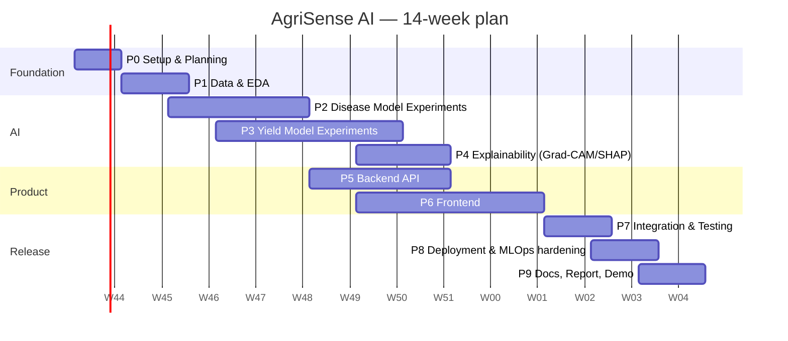

# DEV_PLAN — Development Plan, Phases & Task Breakdown

| Field | Value |
|---|---|
| Document | Development Plan |
| Version | 1.0 (Draft) |
| Date | 24 Oct 2026 |
| Related | `PRD.md`, `SRS.md`, `ARCH.md` |
| Assumed duration | **14 weeks** (one semester). Adjust dates; keep phase order & exit criteria. |
| Team assumption | 1–3 people. Tags: **[ML]** model work · **[BE]** backend · **[FE]** frontend · **[OPS]** MLOps/DevOps · **[DOC]** documentation |

---

## 1. Plan at a Glance



| Phase | Name | Weeks | Primary Output | Milestone |
|---|---|---|---|---|
| P0 | Project setup & planning | 1 | Repo, environments, CI skeleton, docs baseline | M0 |
| P1 | Data acquisition & EDA | 1–2 | Cleaned datasets, splits, EDA reports, scope decision (Q1) | M1 |
| P2 | Disease model experiments | 3–5 | Selected disease model + run comparison | M2 |
| P3 | Yield model experiments | 4–7 | Selected yield model + risk engine | M3 |
| P4 | Explainability integration | 6–8 | Grad-CAM, severity, SHAP modules validated | M4 |
| P5 | Backend API | 7–9 | FastAPI with all endpoints, DB, Storage, KB | M5 |
| P6 | Frontend | 8–11 | Next.js app, all MVP pages | M6 |
| P7 | Integration, testing & real-world evaluation | 11–12 | E2E working system, field-image eval, usability test | M7 |
| P8 | Deployment & MLOps hardening | 12–13 | Public deployment, CI/CD, model registry flow | M8 |
| P9 | Documentation, report & demo | 13–14 | Final report, model cards, demo, handover | M9 |
| P10 | Future extensions (post-semester) | — | Backlog only | — |

> Phases overlap deliberately: backend work starts once a *provisional* model exists (use the best-so-far checkpoint behind a stable interface), so models can be swapped later without API changes.

---

## 2. Global Working Agreements

### 2.1 Git & GitHub Workflow
- **Branches:** `main` (protected, deployable) ← `develop` (optional) ← `feat/<scope>-<desc>`, `fix/…`, `exp/<exp-id>` (experiment code), `docs/…`.
- **Commits:** Conventional Commits (`feat:`, `fix:`, `docs:`, `test:`, `chore:`, `exp:`).
- **PRs:** small, linked to an issue, checklist from PR template, CI must pass, ≥ 1 review (self-review checklist if solo).
- **Issues & Board:** GitHub Projects (columns: Backlog → Ready → In Progress → Review → Done). Label by phase (`P2`) and area (`ml`, `be`, `fe`, `ops`, `docs`).
- **Tags/Releases:** `v0.x.0` per milestone; model versions use their own semver (`disease v1.2.0`).

### 2.2 Definition of Ready (task)
Has description, linked requirement IDs (SRS), acceptance criteria, estimate (≤ 1 day ideal).

### 2.3 Definition of Done (task)
Code merged via PR · tests added/updated and passing · lint/type-check clean · docs updated (README/ADR/model card if relevant) · run record written (for ML tasks) · requirement IDs ticked in the traceability sheet.

### 2.4 Quality Gates
| Gate | Rule |
|---|---|
| Code | `ruff`, `mypy`, `eslint`, `tsc` clean |
| Tests | Backend ≥ 70% coverage; critical logic ≥ 90% |
| ML | Reproducible from config+seed; no test-set tuning; parity test before promotion |
| Security | No secrets in repo; `pip-audit`/`npm audit` no critical findings |
| Docs | Each phase ends with updated docs + short phase report |

### 2.5 Reproducibility Rules (ML)
1. Fixed seeds (`seed_everything`), logged.
2. All hyper-parameters in YAML (`ml/configs/`), snapshotted into the run record.
3. Data split indices saved & versioned via `data_manifest.json` (checksum + seed).
4. Log git SHA + dirty flag in each run.
5. Checkpoint every epoch to Supabase Storage (Kaggle sessions are killed at the quota/12 h limit, with no persistent disk).
6. Test set touched **only** for final reporting.

---

## 3. Repository Bootstrap (Phase 0 commands)

Folder tree is defined in `ARCH.md` §4. Quick bootstrap:

```bash
# 0) Create repo skeleton
mkdir -p agri-ai-platform && cd agri-ai-platform && git init
mkdir -p docs/{adr,api,diagrams,model_cards,reports} \
         frontend backend/app/{core,api/v1/endpoints,schemas,services,ml,db/migrations,utils} \
         backend/tests/{unit,integration,fixtures} backend/scripts \
         ml/{configs/{disease,crop_yield},notebooks/kaggle,knowledge_base,models,reports/figures,tests} \
         ml/src/{common,disease,crop_yield,knowledge} ml/data/{raw,interim,processed,external,manifests} \
         infra/{docker,hf_space} scripts .github/{workflows,ISSUE_TEMPLATE}
touch README.md .env.example Makefile docker-compose.yml
cp ~/Downloads/{PRD,SRS,ARCH,DEV_PLAN}.md docs/

# 1) Backend env
cd backend && python -m venv .venv && source .venv/bin/activate
pip install fastapi "uvicorn[standard]" pydantic pydantic-settings sqlalchemy asyncpg alembic \
            httpx boto3 pillow opencv-python-headless numpy pandas scikit-learn xgboost \
            joblib shap slowapi python-multipart pytest pytest-asyncio ruff mypy
pip install torch torchvision --index-url https://download.pytorch.org/whl/cpu
pip install timm grad-cam onnxruntime
pip freeze > requirements.txt

# 2) Frontend
cd ../frontend && npx create-next-app@latest . --ts --tailwind --eslint --app --src-dir
npm i recharts @tanstack/react-query zod react-hook-form @supabase/supabase-js
npm i -D vitest @testing-library/react playwright prettier

# 3) ML env (Kaggle uses its own image; this is for local smoke tests)
cd ../ml && python -m venv .venv && source .venv/bin/activate
pip install torch torchvision timm pytorch-grad-cam shap scikit-learn xgboost \
            pandas numpy matplotlib seaborn albumentations optuna pyyaml
```

`Makefile` targets: `make setup`, `make dev-be`, `make dev-fe`, `make test`, `make lint`, `make docker-up`, `make export-openapi`.

`.gitignore` essentials: `.env*`, `ml/data/`, `ml/models/`, `ml/artifacts/`, `*.pt`, `*.onnx`, `node_modules/`, `.next/`, `__pycache__/`, `.venv/`.

---

## 4. Phase Details

### Phase 0 — Project Setup & Planning (Week 1)
**Goal:** Everyone can run the skeleton; scope is frozen.

| # | Task | Tag | Req/Ref | Est |
|---|---|---|---|---|
| 0.1 | Create GitHub repo, protect `main`, add PR/issue templates | OPS | NFR-M-006 | 0.5d |
| 0.2 | Generate folder structure (§3), commit baseline docs (`PRD/SRS/ARCH/DEV_PLAN`) | OPS/DOC | — | 0.5d |
| 0.3 | Create accounts/projects: Supabase (Postgres + Storage buckets), Vercel, Render/HF, Kaggle | OPS | — | 0.5d |
| 0.4 | Set `.env.example`; store secrets in platform managers/GitHub Secrets | OPS | NFR-S-002 | 0.5d |
| 0.5 | Backend skeleton: FastAPI app factory, `/health`, config, logging, Dockerfile | BE | FR-M-005/007 | 1d |
| 0.6 | Frontend skeleton: Next.js + Tailwind + layout + navbar + `api-client` | FE | FR-UI-001 | 1d |
| 0.7 | CI workflows (`ci-backend`, `ci-frontend`, `ci-ml`) green on empty tests | OPS | FR-M-006 | 1d |
| 0.8 | Kaggle setup notebook (GPU check, missing deps, dataset glob, Kaggle Secrets, run-record cell, seed util) | ML/OPS | — | 0.5d |
| 0.9 | Decide **Q1** (crops + geography for yield) shortlist | ML | PRD Q1 | 0.5d |
| 0.10 | Set up GitHub Project board; create issues for P1 | DOC | — | 0.5d |

**Exit criteria:** `make dev-be` serves `/health`; `make dev-fe` renders skeleton; CI green; board populated.
**Deliverables:** repo skeleton, CI, ADR-0001..0003, setup notebook.

---

### Phase 1 — Data Acquisition & EDA (Weeks 1–2)
**Goal:** Trustworthy, versioned datasets and a frozen scope.

**Disease data**
| # | Task | Tag | Req | Est |
|---|---|---|---|---|
| 1.1 | Download PlantVillage (Kaggle/TFDS/HF mirror); record source + licence + checksum | ML | C-6 | 0.5d |
| 1.2 | EDA: class counts, imbalance, image sizes, colour stats, sample grids, duplicates (perceptual hashing) | ML | NFR-ML-006 | 1.5d |
| 1.3 | Create **leakage-aware** stratified 70/15/15 splits; save index files + `data_manifest.json` | ML | NFR-ML-006 | 1d |
| 1.4 | Collect/identify **field-image evaluation set** (public field datasets, web-sourced with licence, or self-photographed; even 100–300 images) mapped to PlantVillage classes | ML | NFR-ML-002 | 2d |
| 1.5 | Define augmentation policy v1 (basic) and v2 (strong: background replacement, lighting, blur, cutout) | ML | ML-002 | 1d |

**Yield data**
| # | Task | Tag | Req | Est |
|---|---|---|---|---|
| 1.6 | Shortlist yield datasets (Kaggle, FAOSTAT-style, national agriculture stats) for 2–3 crops in one geography; check years, granularity (district/province), licence | ML | A-2 | 1.5d |
| 1.7 | **Decision Q1:** fix crops + region(s) (ADR-0013) | ML/DOC | PRD Q1 | 0.5d |
| 1.8 | Pull weather via Open-Meteo/NASA POWER for each region/year (`weather_pull.py`), cache raw JSON/CSV | ML | FR-W | 1.5d |
| 1.9 | Source soil attributes (regional/global soil datasets) and join | ML | FR-Y-005 | 1d |
| 1.10 | EDA: yield distributions, trends, missingness, outliers, correlation with weather; define imputation & outlier policies | ML | ML-004 | 2d |
| 1.11 | Define **time/region-based splits** (e.g., train ≤ Y-3, val Y-2, test last 2 years; or leave-region-out) | ML | NFR-ML-006 | 0.5d |
| 1.12 | Draft feature spec v1 (`features.py` schema, versioned) | ML/BE | FR-Y-006 | 1d |

**Exit criteria:** `data_manifest.json` committed; EDA notebooks + short report; Q1 decided; field set exists; splits reproducible.
**Deliverables:** `01_plantvillage_eda.ipynb`, `03_yield_eda.ipynb`, `docs/reports/data_report.md`, ADR-0013.

---

### Phase 2 — Disease Model Experiments (Weeks 3–5)
**Goal:** Choose the production disease model with evidence.

| # | Task | Tag | Exp | Est |
|---|---|---|---|---|
| 2.1 | Build `dataset.py`, `transforms.py`, config loader, run-tracking helpers, metrics (acc/prec/rec/F1/confusion matrix/ECE) | ML | — | 2d |
| 2.2 | **D-01** baseline small CNN from scratch | ML | D-01 | 1d |
| 2.3 | **D-02** ResNet-50 (ImageNet): head-only → full fine-tune; LR schedule, early stopping | ML | D-02 | 1.5d |
| 2.4 | **D-03** EfficientNet-B0 (and B3 if budget) | ML | D-03 | 1.5d |
| 2.5 | **D-04** ViT-B/16 via `timm` (lower LR, layer-wise decay, warm-up) | ML | D-04 | 2d |
| 2.6 | **D-05** Strong augmentation on best candidate(s); ablation vs. basic | ML | D-05 | 1.5d |
| 2.7 | **D-06** Regularization: label smoothing/mixup; class-weighting if imbalance matters | ML | D-06 | 1d |
| 2.8 | **D-07** Evaluate on **field set**; quantify domain gap; try fine-tune with a small portion of field data *without* contaminating the reserved field-test portion | ML | D-07 | 2d |
| 2.9 | Temperature scaling for calibration; choose confidence threshold τ via val set (coverage vs. accuracy curve) | ML | NFR-ML-003 | 1d |
| 2.10 | Error analysis: confusion matrix, hardest classes, misclassified gallery, per-crop metrics | ML | NFR-ML-007 | 1.5d |
| 2.11 | Benchmark inference latency & memory on CPU (PyTorch vs. ONNX Runtime; 224 vs. smaller input) | ML/OPS | NFR-P-001/005 | 1d |
| 2.12 | **Model selection ADR** (accuracy vs. latency vs. size); export final model + `labels.json` + `config.json` + `card.json`; parity test | ML | ML-006/007 | 1d |

**Kaggle workflow (per run)**
```
Open 00_kaggle_setup.ipynb → run setup cells (GPU, deps, secrets)
→ attach the dataset as a Kaggle input (/kaggle/input/<slug>)
→ git clone repo (branch exp/D-0X)
→ python -m ml.src.disease.train --config ml/configs/disease/<cfg>.yaml
   (checkpoints → Supabase Storage each epoch; resume flag supported; time budget enforced)
→ run.json + metrics/plots/artifacts → push to Supabase Storage → commit config + notes
```

**Exit criteria:** comparison table (`compare_runs`) in `docs/reports/disease_experiments.md`; chosen model meets or documents shortfall vs. NFR-ML-001; field-set results reported; artifacts exported and uploaded to Supabase Storage `models/disease/v0.1.0/`.
**Deliverables:** trained models, experiment report, ADR (model choice), `ml/models/disease/*`.

---

### Phase 3 — Yield Model Experiments (Weeks 4–7)
**Goal:** Choose the production yield model + risk method.

| # | Task | Tag | Exp | Est |
|---|---|---|---|---|
| 3.1 | Implement `features.py` (weather aggregates by growth stage, GDD, rainy days, lag yields, rolling means, trend, soil, crop/region encodings) with a **versioned feature schema** | ML | — | 3d |
| 3.2 | **Y-00** Naïve baselines (last year, 3/5-yr mean) | ML | Y-00 | 0.5d |
| 3.3 | **Y-01** Linear/Ridge/Lasso | ML | Y-01 | 1d |
| 3.4 | **Y-02** Random Forest (+ tuning) | ML | Y-02 | 1d |
| 3.5 | **Y-03** XGBoost (Optuna/random search; parent + child run records); early stopping on time-based validation | ML | Y-03 | 2d |
| 3.6 | Feature selection/ablation (weather-only, +soil, +history) to show contribution | ML | — | 1d |
| 3.7 | **Y-04** LSTM on weekly sequences + static features — *only if* rows/years suffice (go/no-go checkpoint at end of 3.5) | ML | Y-04 | 3d |
| 3.8 | **Y-05** Transformer encoder (time-series) — same go/no-go rule; otherwise document "data-limited" | ML | Y-05 | 3d |
| 3.9 | Evaluate: MAE/RMSE/R² overall + per crop/region + unusual-weather years (drought/flood years); residual analysis | ML | NFR-ML-005 | 2d |
| 3.10 | **Y-06** Uncertainty: quantile regression / conformal / ensembles → 80% interval; check coverage | ML | Y-06 | 1.5d |
| 3.11 | **Risk engine** (`risk.py`): baseline ratio + interval rule; backtest against historical bad years; tune thresholds | ML | FR-Y-009 | 1.5d |
| 3.12 | Model selection ADR; export (`joblib`/xgboost JSON/`pt`), feature schema, `card.json`; upload to Supabase Storage `models/yield/v0.1.0/` | ML | ML-007 | 1d |

**Go/No-Go rule for sequence models:** attempt only if ≥ ~10 years × multiple regions/crops with weekly/daily weather align (rule of thumb: a few thousand training rows). If XGBoost on aggregated features is not beaten by LSTM/Transformer under the same time-split, keep XGBoost and report the negative result (valid research finding).

**Exit criteria:** best model outperforms naïve + LR on test split (NFR-ML-004); risk engine backtested; report in `docs/reports/yield_experiments.md`.
**Deliverables:** yield model artifacts, feature schema v1, risk config, experiment report.

---

### Phase 4 — Explainability & Severity (Weeks 6–8)
**Goal:** Reliable, tested explanation modules reusable by the backend.

| # | Task | Tag | Req | Est |
|---|---|---|---|---|
| 4.1 | Grad-CAM wrapper (`ml/src/disease/gradcam_eval.py` → port to `backend/app/ml/gradcam.py`) with per-architecture target layers (+ ViT reshape) | ML/BE | FR-X-001 | 2d |
| 4.2 | Overlay rendering (colormap, alpha blend, same resolution as preview) and PNG output | ML/BE | FR-X-002 | 0.5d |
| 4.3 | Grad-CAM sanity review on ≥ 50 images (correct/incorrect cases); document failure modes (background focus) | ML | FR-X-010, AC-9 | 1.5d |
| 4.4 | Severity module: leaf mask + lesion mask (HSV/Lab thresholds + morphology; optional GrabCut/U-Net); ratio → band | ML | FR-D-013 | 2.5d |
| 4.5 | Annotate 50–100 images for severity (3 bands); compute agreement; tune bands | ML | PRD §7.3 | 1.5d |
| 4.6 | SHAP: choose explainer per model; compute global (summary) and local (waterfall) plots; stability checks | ML | FR-X-005 | 2d |
| 4.7 | Plain-language SHAP sentence templates (feature → human label, units, direction, typical range) | ML/BE | FR-X-006 | 1d |
| 4.8 | Performance: measure Grad-CAM/SHAP time; optimize (no-grad where possible, reuse hooks, cache background data) | BE | NFR-P-001/002 | 1d |
| 4.9 | Unit tests: overlay shape, deterministic outputs on fixtures, SHAP additivity check (`base + Σshap ≈ prediction`) | BE | FR-X-009 | 1d |

**Exit criteria:** Grad-CAM + severity + SHAP modules callable as pure functions with tests; sanity report published.
**Deliverables:** `explainability_report.md`, severity validation table, tested modules.

---

### Phase 5 — Backend API (Weeks 7–9)
**Goal:** Complete FastAPI service honoring `ARCH.md` §7 contracts.

| # | Task | Tag | Req | Est |
|---|---|---|---|---|
| 5.1 | Core: `config.py`, logging with request IDs, error handlers, CORS, rate limiting | BE | NFR-S-006/007 | 1d |
| 5.2 | DB: SQLAlchemy models, Alembic migrations (DDL from ARCH §8.2), Supabase connection (pooler), repositories | BE | §6.1 | 2d |
| 5.3 | Storage service (Supabase Storage; REST API for backend, S3 endpoint for training): upload, presign, delete; EXIF strip | BE | FR-D-006, NFR-S-005 | 1.5d |
| 5.4 | Model registry/loader: read `production.json`, download, cache, load at startup, warm-up, `GET /models` | BE | FR-M-003 | 2d |
| 5.5 | Disease endpoint: validation → preprocess → inference (threadpool) → threshold → Grad-CAM → severity → KB → persist → response | BE | FR-D-001…022 | 3d |
| 5.6 | Knowledge service + seed script from `ml/knowledge_base/disease_knowledge.json`; CI check that every class has an entry | BE/ML | FR-K-001…009 | 2d |
| 5.7 | **Curate KB content** for all supported classes from trusted sources with citations & disclaimers (can start in P2; review in P5) | DOC/ML | FR-K-002 | 3d |
| 5.8 | Weather service: Open-Meteo + NASA POWER adapters, retry, fallback, TTL cache, aggregation | BE | FR-W-001…007 | 2.5d |
| 5.9 | Yield endpoint: validation → weather → features → predict → interval → risk → SHAP → persist | BE | FR-Y-001…017 | 3d |
| 5.10 | `/yield/options`, `/disease/classes`, `/weather` endpoints | BE | FR-Y-002, FR-D-019 | 1d |
| 5.11 | Health/readiness endpoints; graceful-degradation paths (storage/DB/explain failure) | BE | NFR-R | 1d |
| 5.12 | Tests: unit (services), integration (TestClient with fixtures), golden-set regression (ML-008) | BE | NFR-M-001 | 3d |
| 5.13 | Export OpenAPI → `docs/api/openapi.json`; generate TS types for frontend | BE/FE | FR-M-009 | 0.5d |
| 5.14 | (Stretch) Supabase JWT verification, history endpoints, RLS policies, delete flow | BE | FR-A | 2.5d |
| 5.15 | Dockerize; verify memory/cold-start on target host; ADR on hosting choice (Q4) | OPS | NFR-P-005/007 | 1.5d |

**Exit criteria:** all Must endpoints pass integration tests; Swagger usable; image builds and runs with `docker run`; memory within budget.
**Deliverables:** backend service, OpenAPI file, seeded KB, test report.

---

### Phase 6 — Frontend (Weeks 8–11)
**Goal:** Farmer-friendly, responsive, accessible UI wired to the API.

| # | Task | Tag | Req | Est |
|---|---|---|---|---|
| 6.1 | Design tokens, base UI kit (Button, Card, Badge, Alert, Skeleton, Tooltip, Tabs), layout + disclaimer banner | FE | FR-UI-001/006 | 2d |
| 6.2 | Typed API client + React Query + zod schemas (from OpenAPI types) | FE | — | 1d |
| 6.3 | **Disease page:** uploader (drag-drop + camera), client validation/compression, preview, Analyze button | FE | FR-D-001…004 | 2.5d |
| 6.4 | Result view: label, confidence bar (Recharts), top-3, severity badge+tooltip, original vs. Grad-CAM viewer (toggle/slider), recommended actions + sources, uncertain state UI | FE | FR-D-009…017, FR-X-003/004 | 3d |
| 6.5 | **Yield page:** form (react-hook-form+zod), crop/region selectors from `/yield/options`, location picker (lat/lon or map-lite), season/dates | FE | FR-Y-001/003 | 2.5d |
| 6.6 | Weather panel (auto-fetch, preview, editable override) | FE | FR-Y-004 | 1.5d |
| 6.7 | Result view: predicted yield (+ interval), risk badge, baseline comparison chart, SHAP bar chart + sentences | FE | FR-Y-008…015, FR-X-006…008 | 3d |
| 6.8 | **Dashboard:** HealthCard + YieldCard + trend charts using session state (and history if auth) | FE | FR-UI-002/011 | 2d |
| 6.9 | **About/Model info** page (`/models` + static limitations/datasets) | FE | FR-UI-009 | 1d |
| 6.10 | Loading/skeleton, cold-start message, error mapping, retries | FE | FR-UI-004/005 | 1.5d |
| 6.11 | Responsive pass (360 px+), accessibility pass (contrast, ARIA, focus), Lighthouse tuning | FE | NFR-U, NFR-P-004 | 2d |
| 6.12 | (Stretch) Auth pages, History page, saved farms | FE | FR-A | 3d |
| 6.13 | Tests: component tests (vitest), Playwright E2E for both happy paths + error paths (mock API) | FE | FR-UI | 2d |
| 6.14 | Privacy notice + disclaimers + i18n-ready string structure | FE | NFR-PR-001, FR-UI-010 | 1d |

**Exit criteria:** all Must pages complete against deployed/staging API; Lighthouse ≥ 80 mobile; E2E green.
**Deliverables:** frontend app, Storybook/screens (optional), E2E report.

#### Phase 6 as-built verification

- The Must pages are implemented at `/`, `/disease`, `/yield`, `/dashboard`, and
  `/about`, with `/login` covering the auth entry point.
- `npm test` covers the typed API client and shared button accessibility contract.
- `npm run test:e2e` checks all six routes at 360, 390, 768, and 1280 px; all
  24 viewport checks pass without horizontal overflow.
- `npm run lint`, `npx tsc --noEmit`, and `npm run build` pass.
- Production Lighthouse on the mobile viewport scores 100 for performance with
  provided (local) throttling, 96 accessibility, 96 best practices, and 100
  SEO. The default simulated mobile throttle is intentionally recorded
  separately because it measures the local Windows dev host rather than the
  deployed server.
- Static user-facing copy now lives behind a typed English locale object so
  adding Urdu or another locale does not require changing component structure.

---

### Phase 7 — Integration, Testing & Real-World Evaluation (Weeks 11–12)
| # | Task | Tag | Ref | Est |
|---|---|---|---|---|
| 7.1 | Full E2E on staging: frontend ↔ backend ↔ DB ↔ Storage ↔ weather | ALL | UC-1/2/3 | 2d |
| 7.2 | Execute acceptance criteria AC-1…AC-14; log pass/fail with evidence | ALL | SRS §10 | 2d |
| 7.3 | Load/latency test (k6/Locust, ≥ 5 concurrent) + memory profiling; tune workers/threadpool | BE/OPS | NFR-P | 1d |
| 7.4 | Security checklist (upload abuse, CORS, rate limit, expired URL, secrets in bundle) | BE/OPS | NFR-S | 1d |
| 7.5 | **Real-world evaluation:** run production model on field images + phone-camera photos; compute metrics; qualitative error gallery | ML | NFR-ML-002 | 2d |
| 7.6 | Yield sanity check on held-out years/regions; verify live-weather inference matches training feature distributions (train/serve skew check) | ML/BE | FR-Y-006 | 1d |
| 7.7 | Usability test with ≥ 5 participants (task success, SUS); fix top issues | FE/DOC | NFR-U-005 | 2d |
| 7.8 | Bug triage & fixes; freeze features | ALL | — | 2d |

**Exit criteria:** all Must ACs pass; known limitations documented; no P0/P1 bugs open.

#### Phase 7 as-built verification

- Local full-stack integration is covered by the backend endpoint suite and
  frontend browser checks. Five concurrent yield requests all returned HTTP 200
  in the local smoke run.
- Acceptance and security checks cover health/readiness, disease and yield
  contracts, unsupported crops, malformed images, upload limits, CORS,
  redacted errors, rate limiting, and local-storage path traversal.
- See [PHASE7_VERIFICATION.md](./PHASE7_VERIFICATION.md) for command output,
  local pass/fail evidence, and the external gates that require staging
  credentials, field images, or real participants.

---

### Phase 8 — Deployment & MLOps Hardening (Weeks 12–13)
| # | Task | Tag | Ref | Est |
|---|---|---|---|---|
| 8.1 | Deploy frontend to Vercel (env vars, preview deployments) | OPS | — | 0.5d |
| 8.2 | Deploy backend container to chosen host (Render / HF Space / Cloud); secrets, health checks, auto-deploy on `main` | OPS | NFR-PO-001 | 1.5d |
| 8.3 | Production Supabase project: run migrations, RLS (if auth), seed KB; backups verified | OPS/BE | NFR-S-008 | 1d |
| 8.4 | Storage buckets private, CORS config, lifecycle rule (30-day anon purge), model upload, per-object size limit raised for model files, `production.json` | OPS | NFR-S-005, NFR-PR-003 | 1d |
| 8.5 | Model promotion runbook + rollback drill (switch pointer, restart) | OPS | FR-M-004 | 0.5d |
| 8.6 | Register final models (`production.json` pointer + `model_versions` rows carrying `run_id`); sync script from `artifacts/runs/index.jsonl` | ML/OPS | FR-M-001/003 | 1d |
| 8.7 | Uptime monitor + cold-start warm ping; basic logging dashboard; (optional) Sentry | OPS | NFR-R-001 | 0.5d |
| 8.8 | CI/CD finalization: deploy workflow, smoke test post-deploy, dependency scanners | OPS | FR-M-006, NFR-S-009 | 1d |
| 8.9 | Production smoke tests (AC-13/14) and performance verification | ALL | SRS §10 | 1d |
| 8.10 | Cost/limit review (free-tier quotas) and contingency plan | OPS | R4 | 0.5d |

**Exit criteria:** public URLs live; `/health/ready` green; end-to-end demo from a phone succeeds; rollback tested.

#### Phase 8 deployment status

The repository now includes the executable deployment runbook in
[DEPLOY.md](./DEPLOY.md), root Git/Docker ignore rules, frontend/backend CI
workflows, and a tagged backend image workflow. Public hosting, production
Supabase policy configuration, uptime monitoring, and a live rollback drill
remain environment-owned release steps and must be evidenced before the Phase 8
exit criteria are marked fully released.

---

### Phase 9 — Documentation, Report & Demo (Weeks 13–14)
| # | Task | Tag | Est |
|---|---|---|---|
| 9.1 | Model cards (disease, yield): data, metrics, limitations, intended use, ethics | DOC/ML | 1d |
| 9.2 | Final report: intro, related work, datasets, methodology, experiments (tables/plots from run records), XAI analysis, error analysis, system design, deployment, evaluation, limitations, future work | DOC | 4d |
| 9.3 | README (quickstart, architecture image, screenshots, live links), CONTRIBUTING, LICENSE, dataset attributions | DOC | 1d |
| 9.4 | Finalize docs set (PRD/SRS/ARCH updated to as-built; ADRs closed) | DOC | 1d |
| 9.5 | Presentation deck + live demo script + recorded backup video | DOC | 2d |
| 9.6 | Final repo cleanup (remove dead code, pin deps, tag `v1.0.0`) | ALL | 1d |
| 9.7 | Handover checklist (credentials rotation, access, runbook) | OPS | 0.5d |

**Exit criteria:** release `v1.0.0` tagged; report and demo ready.

---

### Phase 10 — Future Extensions (Backlog, post-semester)
| Epic | Description | Depends on |
|---|---|---|
| FX-1 | Crop recommendation model (soil + climate → suitable crops) | Yield data pipeline |
| FX-2 | Irrigation & fertilizer recommendations | Soil/weather features, agronomic rules |
| FX-3 | Weather-risk alerts (scheduled jobs + email/SMS/push) | Weather service, user accounts |
| FX-4 | Additional crops/diseases; collect field-image dataset; retrain | Data collection |
| FX-5 | Farmer history & farm profiles, trend analytics | Auth + history |
| FX-6 | **Agricultural RAG assistant** (verified documents → embeddings in pgvector → citation-based answers) | KB expansion, LLM API |
| FX-7 | **AI agricultural agent** (tool-calling over disease API, yield API, weather, RAG) | FX-6 |
| FX-8 | Localization (multi-language UI, voice input) | i18n structure |
| FX-9 | Drift monitoring & active-learning loop (user-confirmed labels → retraining) | History + consent |

---

## 5. Testing Strategy

| Level | Scope | Tools | Owner |
|---|---|---|---|
| Unit | feature builder, risk engine, severity, preprocessing parity, KB lookup, validators | pytest, vitest | BE/ML/FE |
| ML | metric correctness, seed reproducibility, export parity (1e-4), SHAP additivity | pytest | ML |
| Integration | API ↔ DB ↔ storage (MinIO/moto stand-in for the S3-compatible endpoint) ↔ weather (mocked) | pytest + TestClient/httpx, `respx` | BE |
| Contract | OpenAPI schema vs. frontend types | `openapi-typescript`, schemathesis (optional) | BE/FE |
| Regression | Golden set of images/payloads after every model change (ML-008) | pytest | ML/BE |
| E2E | Disease & yield flows, error flows | Playwright | FE |
| Non-functional | Latency/memory/load; Lighthouse; accessibility (axe) | k6/Locust, Lighthouse | OPS/FE |
| Security | Upload abuse, CORS, rate limit, secrets scanning | manual checklist, `pip-audit`, `npm audit`, `gitleaks` | OPS |
| Usability | 5-user task test, SUS | manual | FE/DOC |

---

## 6. CI/CD Sketch

`.github/workflows/ci-backend.yml`
```yaml
name: ci-backend
on:
  pull_request: { paths: ["backend/**", ".github/workflows/ci-backend.yml"] }
  push: { branches: [main], paths: ["backend/**"] }
jobs:
  test:
    runs-on: ubuntu-latest
    defaults: { run: { working-directory: backend } }
    steps:
      - uses: actions/checkout@v4
      - uses: actions/setup-python@v5
        with: { python-version: "3.11", cache: pip }
      - run: pip install --extra-index-url https://download.pytorch.org/whl/cpu -r requirements.txt
      - run: pip install ruff mypy pytest pytest-cov pytest-asyncio
      - run: ruff check . && ruff format --check .
      - run: mypy app
      - run: pytest --cov=app --cov-fail-under=70
```
`ci-frontend.yml`: `npm ci → npm run lint → npx tsc --noEmit → npm test → npm run build`.
`deploy-backend.yml`: on tag/`main` → build Docker image → deploy hook (Render) → `curl /health/ready` smoke test.

---

## 7. Risk Register (Execution)

| # | Risk | Phase | Trigger | Response |
|---|---|---|---|---|
| 1 | Kaggle weekly GPU quota exhausted / 12 h session kill | P2/P3 | Runs interrupted | Checkpoint+resume every epoch to Supabase Storage, time budget per run, smaller experiments first |
| 2 | Yield data too small for sequence models | P3 | Go/No-Go fails | Keep XGBoost; document negative result |
| 3 | Field-image performance poor | P2/P7 | F1 < 0.5 on field set | Strong augmentation, background mixing, small field fine-tune; honest reporting; stronger "uncertain" UX |
| 4 | Model too heavy for free host | P5/P8 | OOM/timeouts | EfficientNet-B0, ONNX Runtime, quantization, HF Space, or paid small instance |
| 5 | Severity heuristic unreliable | P4 | κ low | Present as coarse (3 bands), lean on Grad-CAM coverage; disclose |
| 6 | KB curation takes too long | P5 | Behind schedule | Prioritize top crops; generic fallback entry per crop; extend later |
| 7 | Weather API schema/limit changes | P5/P8 | Failures | Adapter layer, caching, fallback |
| 8 | Scope creep | All | New feature requests | Park in Phase 10 backlog |
| 9 | Train/serve skew in yield features | P7 | Distribution mismatch | Shared feature code, schema versioning, skew test |
| 10 | Team availability | All | Slippage > 1 week | Cut Stretch items (auth, i18n, LSTM/Transformer) first |

**Cut order if time runs out:** (1) i18n/dark mode → (2) auth/history → (3) LSTM/Transformer → (4) ONNX → (5) prediction intervals → (6) top-3 view. *Never cut:* explainability, KB with citations, run tracking, honest evaluation, deployment.

---

## 8. Week-by-Week Summary

| Week | Focus | Key Outputs |
|---|---|---|
| 1 | P0 + start P1 | Repo, CI, skeletons, accounts, PlantVillage downloaded |
| 2 | P1 | EDA, splits, field set, yield data decision (Q1), weather pulled |
| 3 | P2 | Pipeline code, D-01, D-02 |
| 4 | P2 + P3 start | D-03, D-04; yield features, Y-00/01/02 |
| 5 | P2 finish + P3 | D-05…D-07, calibration, model selection (**M2**); Y-03 |
| 6 | P3 + P4 start | Go/No-Go for sequence models; Grad-CAM wrapper; KB drafting |
| 7 | P3 finish + P4 + P5 start | Yield model + risk (**M3**); SHAP; severity; backend core/DB/storage |
| 8 | P4 finish + P5 + P6 start | **M4**; disease endpoint; UI kit |
| 9 | P5 finish + P6 | Yield endpoint, weather, tests (**M5**); disease UI |
| 10 | P6 | Yield UI, charts, SHAP view |
| 11 | P6 finish + P7 start | Dashboard, About, polish (**M6**); E2E begins |
| 12 | P7 + P8 start | Acceptance tests, real-world eval, usability (**M7**); deploy |
| 13 | P8 + P9 | Production hardening (**M8**); report drafting |
| 14 | P9 | Final report, demo, `v1.0.0` (**M9**) |

---

## 9. Deliverables Checklist

**Code & Infra**
- [ ] Monorepo with structure per `ARCH.md` §4
- [ ] `backend/` FastAPI (Dockerized) with tests
- [ ] `frontend/` Next.js app with tests
- [ ] `ml/` code, configs, notebooks, knowledge base
- [ ] CI/CD workflows; deployed frontend + backend

**Models & Experiments**
- [ ] Disease experiments D-01…D-07 recorded (`artifacts/runs/`)
- [ ] Yield experiments Y-00…Y-06 recorded (Y-04/05 or documented as data-limited)
- [ ] Production models in Supabase Storage + `production.json` + `model_versions` rows
- [ ] Calibration + threshold analysis; field-set evaluation
- [ ] Confusion matrices, per-class analysis, residual analysis, slice analysis

**Explainability**
- [ ] Grad-CAM module + sanity report (≥ 50 images)
- [ ] Severity module + validation subset results
- [ ] SHAP global/local plots + plain-language templates

**Data & Knowledge**
- [ ] `data_manifest.json`, EDA reports, dataset licences/citations
- [ ] Curated `disease_knowledge` with sources for every class

**Documentation**
- [ ] PRD, SRS, ARCH, DEV_PLAN (final, as-built)
- [ ] ADRs, model cards, OpenAPI export
- [ ] README with live links + screenshots
- [ ] Final report, slides, demo video

---

## 10. Immediate Next Steps (first 7 days)
1. Create the GitHub repo and run the bootstrap in §3; commit the four docs into `docs/`.
2. Create Supabase (project + storage buckets), Vercel, Render/HF accounts; save secrets properly.
3. Get `/health` (FastAPI) and the Next.js skeleton running locally; make CI green.
4. Upload PlantVillage as a private Kaggle Dataset, attach it to the setup notebook, and run the first EDA notebook.
5. Shortlist crops + region for yield based on **where you can find ≥ 10 years of yield data**, then lock Decision Q1.
6. Open GitHub issues for all Phase 1 tasks and start the board.